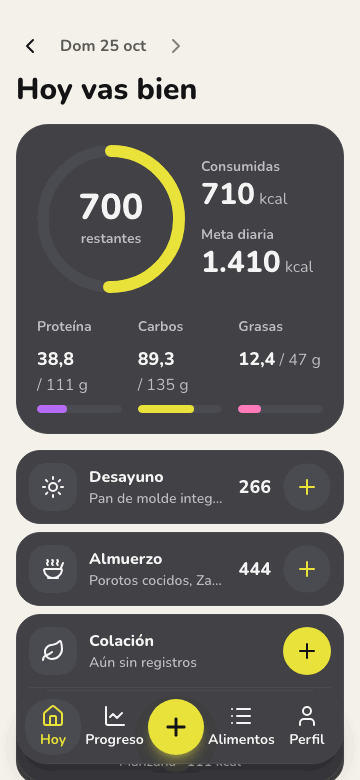
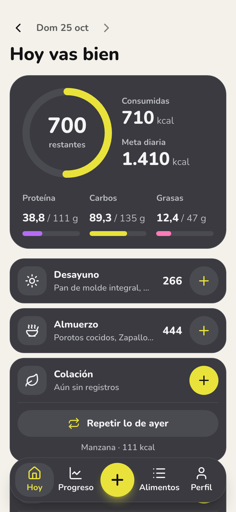
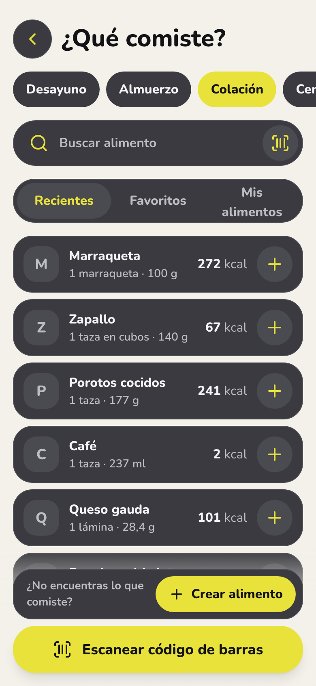
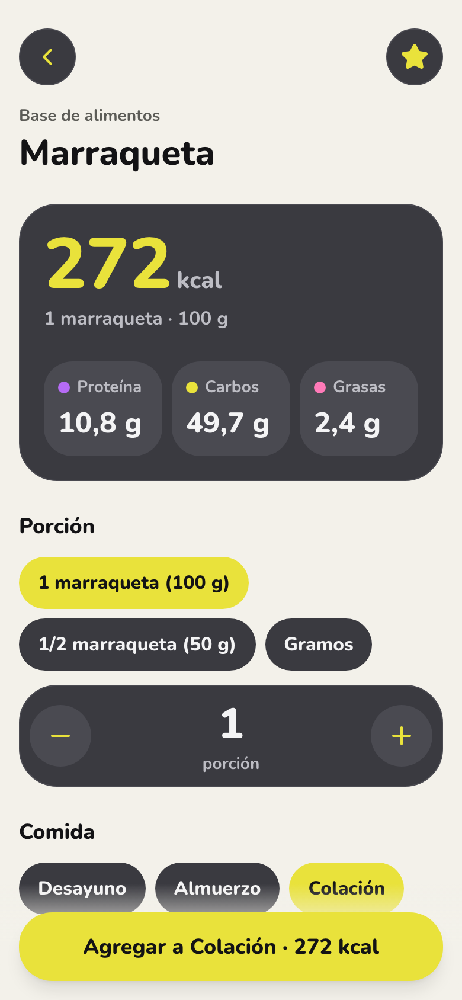
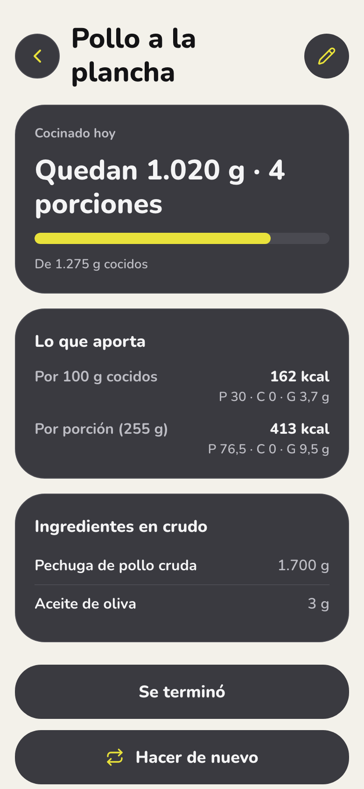
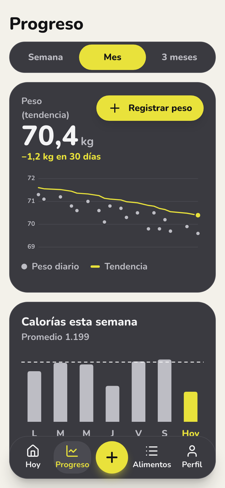
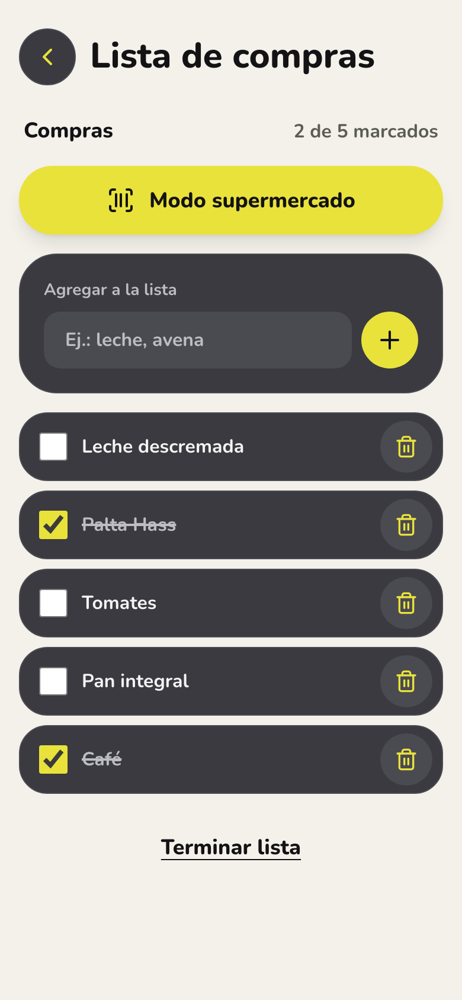
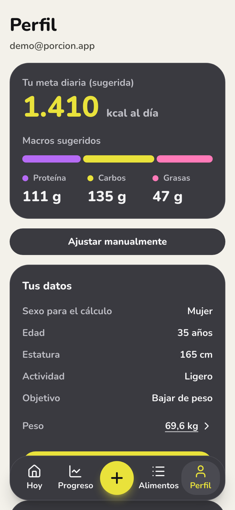

# Porción

Registra lo que comes, tus calorías y macros, y sigue tu peso. Una PWA pensada para el celular, con alimentos chilenos, escaneo de código de barras y un modo supermercado.

**Demo en vivo: [porcion.vercel.app](https://porcion.vercel.app)** · Cuenta de prueba: `demo@porcion.app` / `porcion-demo`

<p align="center">
  
</p>

| Hoy | Agregar | Detalle | Meal prep | Progreso | Lista de compras | Perfil |
|---|---|---|---|---|---|---|
|  |  |  |  |  |  |  |

## Qué hace

- **Meta diaria a tu medida.** Un onboarding de 5 pasos calcula tu meta con Mifflin-St Jeor y sugiere macros. La meta y los macros se pueden fijar a mano, por separado, y volver a lo sugerido cuando quieras.
- **Registrar en dos toques.** Busca sin preocuparte de las tildes ni de los errores de tipeo, o elige entre tus recientes y favoritos. También puedes repetir lo que comiste ayer.
- **Meal prep.** Anota lo que cocinas para la semana con los ingredientes en crudo (buscados o escaneados) y el peso ya cocinado. La app calcula cuánto aporta lo que te sirves, cocido, y descuenta de lo que queda hasta que se termina. Desde el día 4 recuerda revisar que siga bien.
- **Escáner de código de barras.** Busca primero en la base propia y después en Open Food Facts. Si el producto no existe, lo creas con los datos de su etiqueta y queda para todos.
- **Modo supermercado.** Escanea mientras compras: cada producto se marca en tu lista, y los que no tienen tabla nutricional quedan en "Por completar".
- **Progreso.** Tendencia del peso (media móvil exponencial) y las calorías de la semana contra tu meta.
- **Tus datos son tuyos.** Puedes descargar todo en JSON o eliminar tu cuenta desde Perfil.
- **Sin conexión.** Hoy, tus recientes, tus favoritos y tus meal prep se pueden ver sin red.
- **Sin culpa.** Superar la meta se muestra en un tono neutro: nada de rojo ni de "¡te pasaste!".

## Stack

| | |
|---|---|
| Frontend | Vercel · React 19, TypeScript estricto, Vite, Tailwind CSS v4, React Router, TanStack Query |
| Formularios | React Hook Form + Zod, con las reglas de negocio en `src/domain/` |
| Backend | Supabase (São Paulo): Postgres con Row Level Security, Auth (correo y Google), funciones RPC y una Edge Function |
| PWA | `vite-plugin-pwa` (Workbox) y caché de TanStack Query persistida por usuario |
| Escaneo | `BarcodeDetector` nativo, con un respaldo WASM para Safari (`barcode-detector`) |
| Tests | Vitest + Testing Library, pgTAP para la base y Playwright + axe para los flujos y la accesibilidad |

## Arquitectura

```
┌──────────────────────── PWA (React + Vite) ────────────────────────┐
│ features/* → hooks de TanStack Query → lib/supabase · lib/off      │
│            ↘ domain/*: funciones puras (cálculos y reglas)         │
│ Service worker: shell de la app · caché de lectura por usuario     │
└──────────────┬───────────────────────────────────┬─────────────────┘
               │ supabase-js (JWT del usuario)      │ fetch directo
       ┌───────▼──────────────┐            ┌────────▼───────────────┐
       │ Supabase             │            │ Open Food Facts API    │
       │ Auth · Postgres+RLS  │            │ (lectura por código)   │
       │ RPC (funciones SQL)  │            └────────────────────────┘
       │ Edge Function:       │
       │   delete-account     │
       └──────────────────────┘
```

**No hay servidor propio.** Lo que tiene que ser confiable, como los permisos, la unicidad o la ventana para editar un alimento, vive en Postgres: RLS, constraints, triggers y funciones RPC. La única excepción es la Edge Function que elimina la cuenta, porque borrar un usuario de Auth requiere la `service_role` key, y esa key nunca llega al navegador.

```
src/
  app/        router, guardas por etapa, caché
  features/   auth, onboarding, today, foods, scanner, shopping, progress, profile, legal
  domain/     lógica de negocio pura, con 100 % de cobertura
  lib/        cliente de Supabase, Open Food Facts, utilidades
  ui/         componentes base (Button, Sheet, Ring, MacroBar…)
supabase/     migraciones, tests pgTAP, plantillas de correo y la Edge Function
data/         fuentes del seed de alimentos (CSV y recetas)
e2e/          flujos de Playwright y revisión de accesibilidad
```

## Decisiones técnicas

- **Los cálculos son funciones puras.** kcal por porción, Mifflin-St Jeor, macros, el chequeo 4/4/9 y la tendencia del peso viven en `src/domain/`, sin React ni Supabase, con tests y un umbral de cobertura del 90 % en CI.
- **Cada registro guarda una copia de sus valores.** Al registrar una comida se guardan sus kcal y macros, así editar o borrar el alimento después no cambia el historial.
- **Valores por 100 g, porciones en gramos.** Los nutrientes se guardan siempre por 100 g (o 100 ml), y "1 marraqueta" es una equivalencia de 100 g. Los valores se redondean solo al mostrarlos.
- **Una base compartida con control de calidad.** Lo que crea la comunidad queda visible para todos de inmediato, pero solo su autor lo puede editar, durante 24 h o mientras nadie más lo haya registrado. El autor no se muestra a nadie. Con 3 reportes, el alimento muestra "Datos en revisión".
- **Búsqueda tolerante en Postgres.** `unaccent` y `pg_trgm` ordenan por prefijo exacto, luego por similitud, luego por alimento verificado y al final por tu propio uso.
- **Meal prep: al cocinar cambia el peso, no las calorías.** La pechuga pierde agua y el arroz la absorbe, así que los valores de una etiqueta en crudo no sirven para lo que pesas cocido. Un lote suma sus ingredientes crudos y divide por su peso cocido. Lo que queda no se guarda: se calcula desde los gramos registrados, así editar o borrar un registro nunca deja un contador desfasado.
- **Gráficos en SVG propio.** Son dos gráficos simples, así que no se justificaba una librería. Así usan los colores del sistema visual, y cada uno trae una tabla oculta con sus datos para lectores de pantalla.
- **Caché sin conexión separada por usuario.** Solo se guarda lo que hay que poder leer sin red, con una clave por usuario que se borra al cerrar sesión.
- **Accesibilidad verificada en CI.** axe (WCAG 2.1 AA), áreas táctiles de 44 px y foco visible al navegar con teclado, en todas las pantallas principales.

## Privacidad

Peso, objetivos y alimentación pueden ser datos de salud, así que la app los trata con consentimiento explícito y pide solo lo necesario (ver la Ley 21.719 de Chile).

- No pide RUT, teléfono ni dirección, y no tiene analítica ni rastreadores.
- RLS en todas las tablas: cada persona solo ve lo suyo.
- Se guardan la versión y la fecha de la política aceptada. Si la política cambia, la app pide aceptarla de nuevo.
- Desde Perfil puedes descargar todos tus datos o eliminar tu cuenta.

La Política de privacidad y los Términos están en la app (`/privacy`, `/terms`). Son un **borrador sin revisión legal**.

## Cómo correrlo

Necesitas Node 22, Docker y la [CLI de Supabase](https://supabase.com/docs/guides/cli).

```bash
npm install
supabase start                 # Supabase local, con migraciones y seed
cp .env.example .env.local     # pega la API URL y la anon key que imprime supabase start
npm run dev                    # http://localhost:5173
npm run demo:seed              # opcional: crea la cuenta demo con datos de ejemplo
```

| Comando | Qué hace |
|---|---|
| `npm run test` / `test:coverage` | Vitest (unitarios y componentes), con el umbral de cobertura de `src/domain/` |
| `npm run test:db` | Tests pgTAP de RLS, triggers y funciones |
| `npm run test:e2e` | Playwright contra el Supabase local, con escaneo por cámara simulada y revisión con axe |
| `npm run lint` / `typecheck` | ESLint y TypeScript |
| `npm run seed:build` | Valida `data/` y regenera `supabase/seed.sql` |
| `npm run db:types` | Regenera los tipos de la base |

Ingresar con Google y probar en el teléfono requieren pasos extra, que están en `CLAUDE.md`.

## Créditos

- **Datos nutricionales:** U.S. Department of Agriculture, FoodData Central (dominio público). FAO y Ministerio de Salud de Chile 2010, Tabla Chilena de Composición Química de Alimentos (uso no comercial), solo para alimentos chilenos que USDA no tiene. Detalle en [`data/README.md`](data/README.md).
- **[Open Food Facts](https://world.openfoodfacts.org/):** los productos escaneados vienen de Open Food Facts, una base colaborativa bajo [Open Database License](https://opendatacommons.org/licenses/odbl/1-0/). Su contenido está bajo [Database Contents License](https://opendatacommons.org/licenses/dbcl/1-0/).
- Íconos de [Lucide](https://lucide.dev/) y tipografía [Nunito](https://fonts.google.com/specimen/Nunito).

## Licencia

El código está bajo licencia [MIT](LICENSE). Los datos del seed mantienen la licencia de su fuente: las filas de FAO/MINSAL 2010 son solo para uso no comercial.
